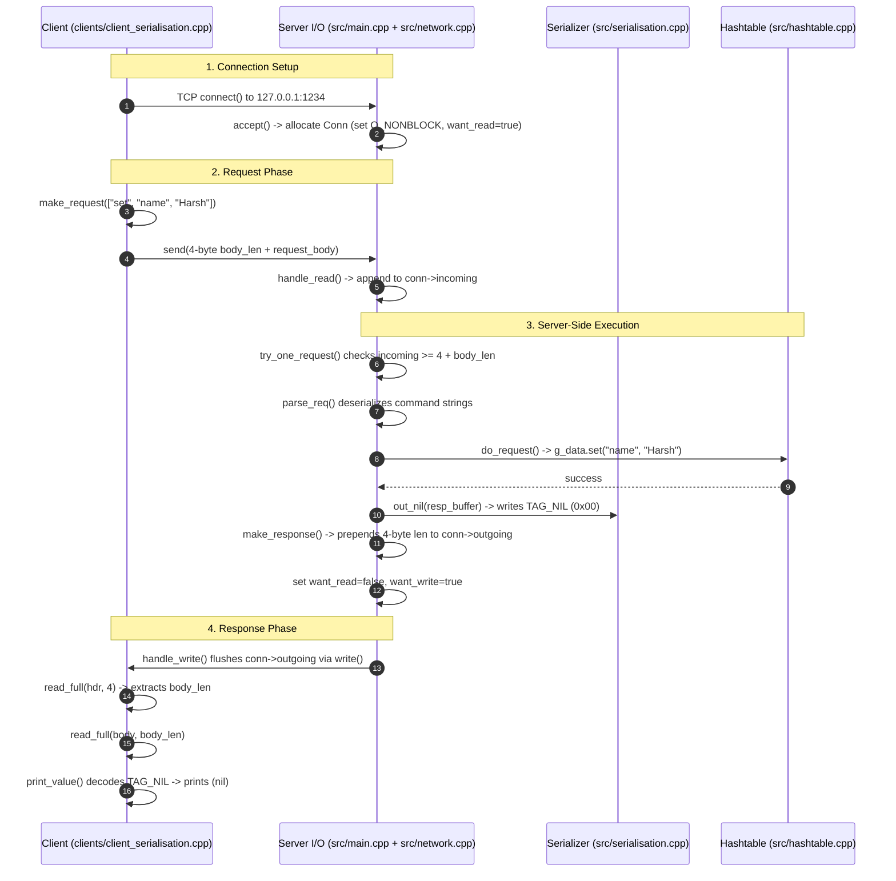
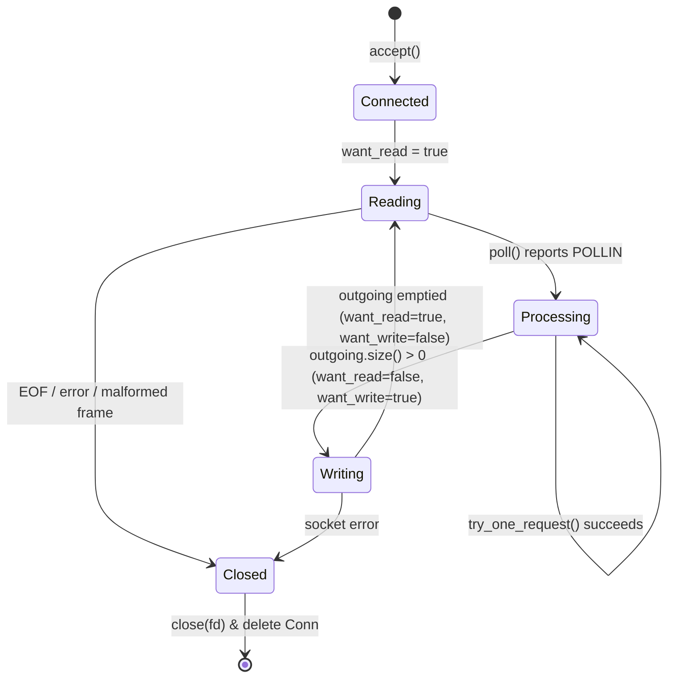

# Binary Wire Protocol Specification (Client & Server)

A complete specification of the binary request/response protocol used between the client and the Redis-like key-value server, covering wire formats, state machines, and implementation details for **both the client side and the server side**.

---

## Table of Contents
1. [Overview & Characteristics](#1-overview--characteristics)
2. [End-to-End Sequence Diagram](#2-end-to-end-sequence-diagram)
3. [Primitive Data Types](#3-primitive-data-types)
4. [Client-Side Protocol Details](#4-client-side-protocol-details)
   - [Request Serialization](#41-request-serialization)
   - [Transmission & Partial Writes](#42-transmission--partial-writes)
   - [Response Reception & Frame Assembly](#43-response-reception--frame-assembly)
   - [Recursive Tag Parsing](#44-recursive-tag-parsing)
   - [Client-Side Pipelining](#45-client-side-pipelining)
5. [Server-Side Protocol Details](#5-server-side-protocol-details)
   - [Non-Blocking Connection State Machine](#51-non-blocking-connection-state-machine)
   - [Stream Accumulation & Framing](#52-stream-accumulation--framing)
   - [Request Deserialization & Validation](#53-request-deserialization--validation)
   - [Command Dispatching](#54-command-dispatching)
   - [Typed Response Serialization Engine](#55-typed-response-serialization-engine)
   - [Response Framing & Non-Blocking Transmission](#56-response-framing--non-blocking-transmission)
6. [Wire Frame Formats & Byte Dumps](#6-wire-frame-formats--byte-dumps)
7. [Commands & Status Codes](#7-commands--status-codes)
8. [Connection Teardown & Security Invariants](#8-connection-teardown--security-invariants)

---

## 1. Overview & Characteristics

| Property | Value | Description |
|---|---|---|
| **Transport** | TCP | Reliable byte stream over `127.0.0.1:1234` |
| **Framing** | Length-prefixed | Every message starts with a 4-byte `u32 body_len` header |
| **Byte Order** | Little-endian | All integers (`u32`, `i64`, `f64`) transmit least-significant byte first |
| **Max Frame Body** | 1 MiB (`1,048,576` bytes) | Enforced on both sides to guard against memory exhaustion |
| **Session Model** | Connection-oriented, stateless | No handshake, no authentication, no version negotiation |
| **Ordering** | Strict FIFO | Responses are returned in the exact order requests were received |
| **Pipelining** | Fully supported | Client can burst $N$ requests without waiting for intermediate responses |

---

## 2. End-to-End Sequence Diagram



---

## 3. Primitive Data Types

All multi-byte numeric fields are encoded and decoded using explicit bit shifts to guarantee **little-endian** endianness regardless of the host CPU architecture:

| Type | Wire Size | Format |
|---|---|---|
| `u8` | 1 byte | Raw unsigned byte (`0` to `255`) |
| `u32` | 4 bytes | Unsigned 32-bit integer, little-endian: `byte[0] \| (byte[1]<<8) \| (byte[2]<<16) \| (byte[3]<<24)` |
| `i64` | 8 bytes | Signed two's-complement 64-bit integer, little-endian |
| `f64` | 8 bytes | IEEE 754 double-precision floating point, little-endian bit pattern |
| `str` | Variable | Binary-safe: `u32 len` followed by `len` raw bytes (no null terminator) |

---

## 4. Client-Side Protocol Details

The client implementation lives in [`clients/client_serialisation.cpp`](file:///c:/Users/harsh/Desktop/redis_windows/clients/client_serialisation.cpp).

### 4.1 Request Serialization
The client constructs a request from a `std::vector<std::string>` command list:
1. Writes the string count `nstr` as a 4-byte `u32`.
2. For each string:
   - Appends its length `len` as a 4-byte `u32`.
   - Appends the raw string bytes.
3. Calculates `body_size = out.size()`.
4. Prepends the 4-byte `body_size` header to form the final frame.

```cpp
// Client request serialization logic
vector<uint8_t> make_request(const vector<string>& cmd) {
    vector<uint8_t> out;
    uint32_t nstr = static_cast<uint32_t>(cmd.size());
    append_u32(out, nstr);
    for (const string &s : cmd) {
        append_u32(out, static_cast<uint32_t>(s.size()));
        out.insert(out.end(), s.begin(), s.end());
    }

    vector<uint8_t> request;
    append_u32(request, static_cast<uint32_t>(out.size()));
    request.insert(request.end(), out.begin(), out.end());
    return request;
}
```

### 4.2 Transmission & Partial Writes
TCP stream semantics mean `send()` might transmit only part of a buffer. The client loops until all bytes are sent:

```cpp
bool send_request(int fd, vector<uint8_t>& request) {
    size_t total_sent = 0;
    while (total_sent < request.size()) {
        ssize_t rv = send(fd, request.data() + total_sent, request.size() - total_sent, 0);
        if (rv < 0) {
            perror("send");
            return false;
        }
        total_sent += static_cast<size_t>(rv);
    }
    return true;
}
```

### 4.3 Response Reception & Frame Assembly
The client reads the response in two distinct, atomic steps using a helper `read_full`:
1. Reads exactly **4 bytes** to extract `body_len`.
2. Validates that `body_len <= 1 MiB`.
3. Reads exactly `body_len` bytes into a buffer before starting deserialization.

```cpp
static int32_t read_full(int fd, uint8_t* buf, size_t n) {
    while (n > 0) {
        ssize_t rv = read(fd, buf, n);
        if (rv < 0 && errno == EINTR) continue; // retry interrupted syscall
        if (rv <= 0) return -1;                // EOF or socket error
        n -= (size_t)rv;
        buf += rv;
    }
    return 0;
}
```

### 4.4 Recursive Tag Parsing
The client inspects the first byte (`d[0]`) to identify the data tag, parses the payload, and returns the total number of bytes consumed (enabling recursive decoding of arrays and nested error messages):

```cpp
static int32_t print_value(const uint8_t *d, size_t size, int indent = 0) {
    if (size < 1) return -1;
    switch (d[0]) {
        case TAG_NIL: return 1;
        case TAG_STR: {
            uint32_t len = get_u32(d + 1);
            cout << "(str) \"" << string((const char*)d + 5, len) << "\"\n";
            return 5 + len;
        }
        case TAG_INT: { /* read 8 bytes -> int64_t */ return 9; }
        case TAG_DBL: { /* read 8 bytes -> double */  return 9; }
        case TAG_ERR: {
            uint32_t code = get_u32(d + 1);
            // nested TAG_STR starts at offset 5
            uint32_t len = get_u32(d + 6);
            cout << "(err) [" << code << "] " << string((const char*)d + 10, len) << "\n";
            return 10 + len;
        }
        case TAG_ARR: {
            uint32_t n = get_u32(d + 1);
            size_t pos = 5;
            for (uint32_t i = 0; i < n; i++) {
                int32_t rv = print_value(d + pos, size - pos, indent + 2);
                if (rv < 0) return -1;
                pos += (size_t)rv;
            }
            return (int32_t)pos;
        }
    }
}
```

### 4.5 Client-Side Pipelining
Because the protocol guarantees strict FIFO ordering, the client can issue multiple requests without waiting:
```cpp
// Pipelined: send two requests back-to-back
vector<uint8_t> req1 = make_request({"set", "k1", "v1"});
vector<uint8_t> req2 = make_request({"get", "k1"});
send_request(fd, req1);
send_request(fd, req2);

// Then read two responses sequentially
receive_response(fd); // Expects: TAG_NIL
receive_response(fd); // Expects: TAG_STR "v1"
```

---

## 5. Server-Side Protocol Details

The server protocol engine is implemented across:
- Connection loop: [`src/main.cpp`](file:///c:/Users/harsh/Desktop/redis_windows/src/main.cpp)
- Protocol framing & dispatch: [`src/network.cpp`](file:///c:/Users/harsh/Desktop/redis_windows/src/network.cpp)
- Serialization primitives: [`src/serialisation.cpp`](file:///c:/Users/harsh/Desktop/redis_windows/src/serialisation.cpp)

### 5.1 Non-Blocking Connection State Machine

Each connection is tracked by `struct Conn` ([`include/connection.h`](file:///c:/Users/harsh/Desktop/redis_windows/include/connection.h)):



### 5.2 Stream Accumulation & Framing
In `handle_read(Conn *conn)`, incoming bytes are appended to `conn->incoming`. Then, `try_one_request(conn)` extracts frames in a loop:

1. **Header Check:** If `conn->incoming.size() < 4`, return `false` (keep waiting for data).
2. **Length Extraction:** Read 4-byte `len`. If `len > 1 MiB`, mark `conn->want_close = true` and abort.
3. **Body Arrival Check:** If `conn->incoming.size() < 4 + len`, return `false` (partial frame; wait for next `POLLIN`).
4. **Processing & Consumption:**
   - Pass slice `&conn->incoming[4]` with length `len` to `parse_req()`.
   - Call `do_request()` to generate serialized response into `conn->outgoing`.
   - Strip processed bytes from buffer: `buf_consume(conn->incoming, 4 + len)`.
   - Return `true` to loop and check for pipelined requests in the same buffer.

### 5.3 Request Deserialization & Validation
In `parse_req()` ([`src/network.cpp:30-59`](file:///c:/Users/harsh/Desktop/redis_windows/src/network.cpp#L30-L59)):
* Safely reads `u32 nstr` via `read_u32()`.
* Iterates `nstr` times, extracting each `u32 len` and verifying `data + len <= end`.
* **Strict Validation Rule:** Rejects and terminates connection if `data != end` after parsing `nstr` strings (guards against trailing garbage bytes).

### 5.4 Command Dispatching
In `do_request(cmd, out)` ([`src/network.cpp:64-84`](file:///c:/Users/harsh/Desktop/redis_windows/src/network.cpp#L64-L84)):
* Compares `cmd[0]` against supported commands (`get`, `set`, `erase`).
* Interacts with `Hashtable g_data`.
* Writes typed output directly into `tempBuffer &out` using serialization helpers.

### 5.5 Typed Response Serialization Engine
Implemented in [`src/serialisation.cpp`](file:///c:/Users/harsh/Desktop/redis_windows/src/serialisation.cpp):

```cpp
void out_nil(tempBuffer& out) {
    out.push_back(TAG_NIL);
}

void out_str(tempBuffer& out, const string& value) {
    out.push_back(TAG_STR);
    append_u32(out, static_cast<uint32_t>(value.size()));
    out.insert(out.end(), value.begin(), value.end());
}

void out_err(tempBuffer& out, uint32_t code, const string& message) {
    out.push_back(TAG_ERR);
    append_u32(out, code);
    out_str(out, message); // Nests TAG_STR
}

void out_int(tempBuffer& out, int64_t value) {
    out.push_back(TAG_INT);
    append_i64(out, value);
}

void out_dbl(tempBuffer& out, double value) {
    out.push_back(TAG_DBL);
    append_i64(out, *reinterpret_cast<uint64_t*>(&value));
}

void out_arr(tempBuffer& out, uint32_t count) {
    out.push_back(TAG_ARR);
    append_u32(out, count);
}
```

### 5.6 Response Framing & Non-Blocking Transmission
1. In `make_response()`, the server prepends the 4-byte response length to `conn->outgoing`:
   ```cpp
   uint32_t len = static_cast<uint32_t>(resp.size());
   append_u32(conn->outgoing, len);
   conn->outgoing.insert(conn->outgoing.end(), resp.begin(), resp.end());
   ```
2. In `handle_write()`, bytes are flushed via non-blocking `write()`.
3. If `write()` returns `EAGAIN` or `EWOULDBLOCK`, remaining bytes stay in `conn->outgoing` and the server waits for the next `POLLOUT` event.
4. When `conn->outgoing` is completely drained, the server toggles `want_read = true` and `want_write = false`.

---

## 6. Wire Frame Formats & Byte Dumps

### Request Frame Format
```text
+-------------------+-------------------+-------------------+-------------------+-----+
|   u32 body_len    |     u32 nstr      |    u32 len_1      |   bytes_1 (data)  | ... |
|     (4 bytes)     |     (4 bytes)     |     (4 bytes)     |   (len_1 bytes)   | ... |
+-------------------+-------------------+-------------------+-------------------+-----+
```

#### Example 1: `SET key val`
```text
Offset  Bytes                   Description
----------------------------------------------------------------------
0000    12 00 00 00             Frame length: 18 bytes (0x00000012)
0004    03 00 00 00             nstr = 3 strings
0008    03 00 00 00 73 65 74    String 1: len=3, "set"
000F    03 00 00 00 6B 65 79    String 2: len=3, "key"
0016    03 00 00 00 76 61 6C    String 3: len=3, "val"
```

#### Example 2: `GET key`
```text
Offset  Bytes                   Description
----------------------------------------------------------------------
0000    0E 00 00 00             Frame length: 14 bytes (0x0000000E)
0004    02 00 00 00             nstr = 2 strings
0008    03 00 00 00 67 65 74    String 1: len=3, "get"
000F    03 00 00 00 6B 65 79    String 2: len=3, "key"
```

---

### Response Frame Formats

#### 1. `TAG_NIL` (0x00)
Used on successful `SET` or `ERASE`.
```text
01 00 00 00   # Frame length = 1
00            # TAG_NIL
```

#### 2. `TAG_STR` (0x02)
Returned on successful `GET`.
```text
08 00 00 00   # Frame length = 8
02            # TAG_STR
03 00 00 00   # String length = 3
76 61 6C      # "val"
```

#### 3. `TAG_ERR` (0x01)
Nested layout: `[TAG_ERR][u32 code][TAG_STR][u32 len][message]`.
```text
1B 00 00 00                             # Frame length = 27
01                                      # TAG_ERR
94 01 00 00                             # Error code = 404 (0x00000194)
02                                      # TAG_STR
11 00 00 00                             # String length = 17
4B 65 79 20 44 6F 65 73 6E 27 74 20     # "Key Doesn't "
65 78 69 73 74                          # "exist"
```

#### 4. `TAG_INT` (0x03)
Holds a 64-bit signed integer.
```text
09 00 00 00                             # Frame length = 9
03                                      # TAG_INT
E7 03 00 00 00 00 00 00                 # Value = 1000 (0x00000000000003E7)
```

#### 5. `TAG_DBL` (0x04)
Holds an 8-byte IEEE 754 floating point number.
```text
09 00 00 00                             # Frame length = 9
04                                      # TAG_DBL
00 00 00 00 00 00 34 40                 # Value = 20.0
```

#### 6. `TAG_ARR` (0x05)
Array containing 2 elements: `[int 10, str "hi"]`.
```text
12 00 00 00                             # Frame length = 18
05                                      # TAG_ARR
02 00 00 00                             # Count = 2 elements
03 0A 00 00 00 00 00 00 00              # Element 1: TAG_INT 10
02 02 00 00 00 68 69                    # Element 2: TAG_STR "hi"
```

---

## 7. Commands & Status Codes

| Command | Request Structure | Success Response | Failure Response |
|---|---|---|---|
| `get` | `["get", "<key>"]` | `TAG_STR <value>` | `TAG_ERR 404 "Key Doesn't exist"` |
| `set` | `["set", "<key>", "<value>"]` | `TAG_NIL` | — |
| `erase` | `["erase", "<key>"]` | `TAG_NIL` | `TAG_ERR 404 "Key Doesn't exist"` |
| `subscribe` | `["subscribe", "<ch1>", ...]` | `TAG_ARR(3) ["subscribe", "<ch>", count]` *(per channel)* | `TAG_ERR 400 "ERR wrong number of arguments"` |
| `unsubscribe` | `["unsubscribe", ["<ch1>"]...]` | `TAG_ARR(3) ["unsubscribe", "<ch>", remaining]` | — |
| `publish` | `["publish", "<channel>", "<msg>"]` | `TAG_INT <receivers_count>` | `TAG_ERR 400 "ERR wrong number of arguments"` |
| `ping` | `["ping", ["<msg>"]]` | `TAG_STR "PONG"` or `TAG_ARR(2) ["pong", "<msg>"]` | — |
| `quit` | `["quit"]` | `TAG_NIL` (closes connection) | — |
| *Invalid* | *Any other command or arity* | — | `TAG_ERR 404 "unrecognized command"` |
| *Context Error* | *Disallowed command in Pub/Sub mode* | — | `TAG_ERR 400 "ERR only (P)SUBSCRIBE / (P)UNSUBSCRIBE / PING / QUIT allowed in this context"` |

---

## 8. Connection Teardown & Security Invariants

The server will immediately terminate a connection (`close(fd)` and destroy `Conn`) under any of the following conditions:

1. **Buffer Limit Breach:** A frame length header specifies `len > 1024 * 1024` (1 MiB).
2. **Buffer Overrun / Truncation:** A length prefix points past the declared end of the frame body.
3. **Trailing Garbage:** Unparsed bytes remain after `nstr` strings have been extracted.
4. **Malformed Sub-tags:** An error tag payload does not contain `TAG_STR` at the expected offset.
5. **Client Disconnection / TCP Reset:** `read()` returns `0` (clean EOF) or `< 0` with an unrecoverable socket error.
